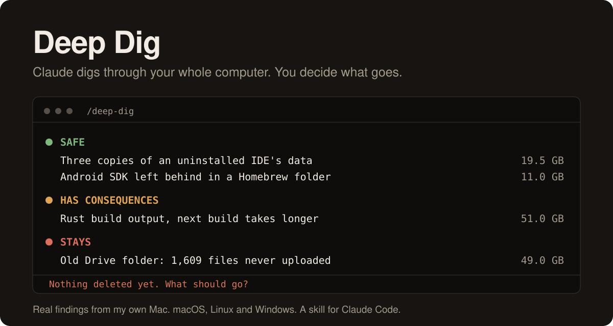
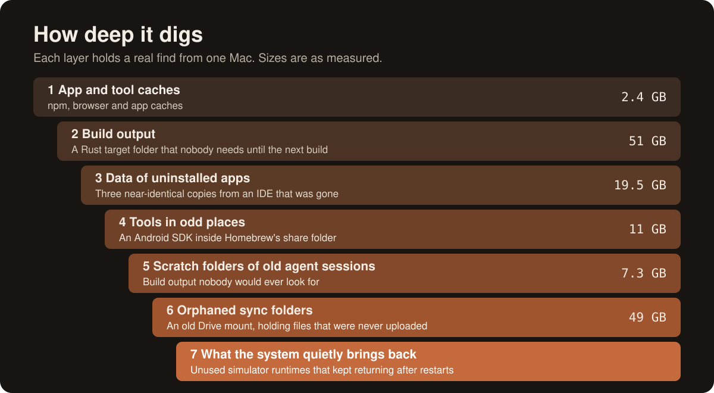
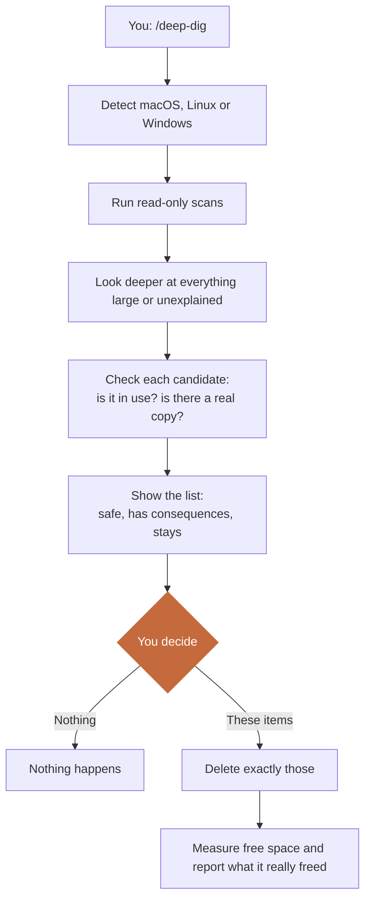

<p align="center">
  
</p>

# Deep Dig

I tried every cleaner I could get my hands on. None of them dug as deep as Claude did when I simply asked it to look.

So I turned what Claude kept doing on my Mac into a reusable skill. It digs through your whole computer, gives you a list, and doesn't delete a thing until you explicitly say so.

Over a few rounds, my Mac went from 2 GB free to about 80 GB.

## Why it finds more

A cleaner matches folders it already knows. Claude can look at a 19 GB folder it has never seen, work out what it is, compare it with what you have installed, and tell you whether anything depends on it.

<p align="center">
  
</p>

## How it works



A list looks like this:

| | Found | Size | What happens if it goes |
|---|---|---:|---|
| 🟢 Safe | Old package cache | 2.4 GB | Rebuilds on the next install |
| 🟠 Has consequences | Rust build output | 51 GB | The next build takes longer |
| 🔴 Stays | Old Drive folder | 49 GB | 1,609 files in it were never uploaded |

## The rule it doesn't bend

**Nothing gets deleted without your explicit approval.** That holds when the disk is nearly full too. Approval covers the items you name, in that round. "Leave the rest" means leave the rest.

This matters more than it sounds. On my Mac, these checks stopped real losses:

- An old Google Drive folder looked like a leftover. The online copy had 674 files, the folder had 1,851.
- A project looked safe to remove because it was "already on Drive". The copy there had 107 of its 753 files.
- A backup Git repo looked redundant. It held 7 loose objects that exist nowhere else.

### What protects you, exactly

| Layer | What it does | Limit |
|---|---|---|
| Scan scripts | Only read. You can check that in `scripts/`. | |
| Skill instructions | Tell Claude to ask first, verify, and delete only what you named. | They are instructions to an AI, not a technical lock. |
| Claude Code permissions | Prompt you before commands run. | Only if you leave them on. |

Keep permission prompts on and read the commands. If you run with permissions bypassed, the instructions are all that stands between Claude and your files.

## What it looks for

- Caches, build output and package manager leftovers
- Data of apps you no longer have, and apps you may have forgotten
- Hidden folders, large forgotten files, old installers
- Zips next to their unpacked folders
- Build folders in projects that have been idle for months
- Old coding agent worktrees and scratch folders
- Background services whose program is gone
- Simulator runtimes, WSL disks, Docker data, Btrfs snapshots, `Windows.old`
- Stuck cloud sync: why Google Drive shows thousands of errors, and why your files don't arrive

It also explains what macOS calls "System Data", so you can see what's in that number.

## Install

You need [Claude Code](https://claude.com/claude-code).

macOS and Linux:

```bash
git clone https://github.com/noxpublishing/deep-dig ~/.claude/skills/deep-dig
```

Windows (PowerShell):

```powershell
git clone https://github.com/noxpublishing/deep-dig "$env:USERPROFILE\.claude\skills\deep-dig"
```

Then start Claude Code and type `/deep-dig`, or just ask "what can I delete?".

## Test status

| System | Status |
|---|---|
| macOS | Built from weeks of cleanups on my own Mac. Both scan scripts have run there. |
| Linux | Syntax checked only, has not run on a real system yet |
| Windows | Has not been run yet |

Linux and Windows are the least proven parts. The scripts only read, so a bug should give you a wrong or missing list, not a loss. If something breaks, please open an issue with the output.

## License

MIT. Not affiliated with Anthropic.
